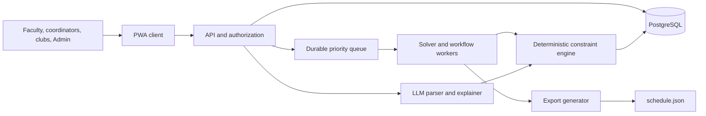
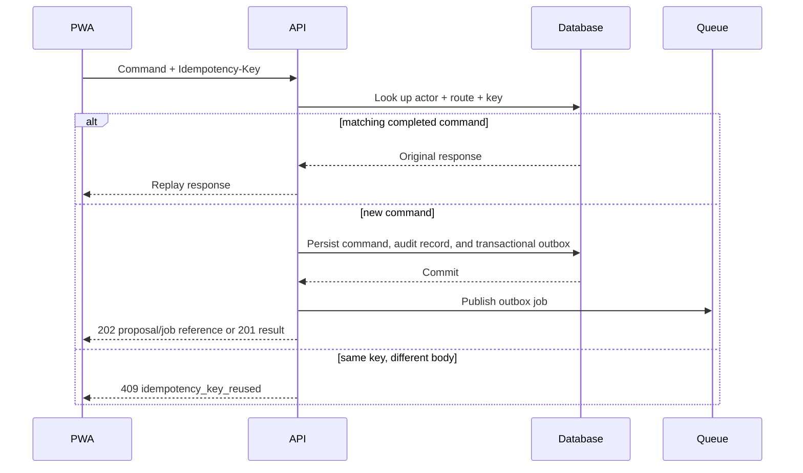

# TechZephyr 4 — CIT Scheduling Platform Architecture

## 1. Product boundary

TechZephyr 4 is a role-based web platform for Chilika Institute of Technology (CIT). It generates the weekly teaching timetable, schedules midsem exams, processes Spectra venue requests, and proposes repair plans after disruptions. It consumes the starter-pack dataset and change-file formats; it does not hard-code the public dataset.

`validator.py` is the compatibility contract and final source of truth for schedule validity. The application may provide richer explanations or earlier feedback, but every generated export and every proposal must pass equivalent deterministic checks before an Admin can apply it.

## 2. System overview

The API accepts commands and records their intent. Workers perform expensive scheduling, repair, parsing follow-up, export, and notification work. The deterministic constraint engine is a shared library used by API pre-checks and workers; only its result can change schedule state. An LLM may extract a booking draft or explain an already computed outcome, but it cannot decide validity, priority, or placement.

## 3. Core components

| Component | Owns | Key rule |
| --- | --- | --- |
| PWA client | Timetable views, booking form, approval screens, local offline outbox | Shows stale/offline state and never treats a local draft as approved. |
| API | Authentication, role authorization, idempotent commands, audit trail, current read models | Performs no long solver run inline. |
| PostgreSQL | Dataset imports, schedule versions, proposals, booking decisions, outbox, idempotency records | A schedule version is immutable once approved. |
| Constraint engine | Timetable, booking, exam, and disruption checks; objective calculation | Must reproduce `validator.py` semantics. |
| Solver worker | New timetable generation and minimum-change repair | Emits a proposal, never directly publishes it. |
| Booking worker | Candidate generation and priority-aware booking decisions | Applies category caps and submission-time tie-breaks. |
| Export worker | `schedule.json` and `schedule_after.json` in the official shape | Runs the official validator before marking an export ready. |
| AI adapter | Hinglish/English request extraction and decision explanations | Produces editable drafts only; it is optional. |

## 4. Domain model and versioning

Store each uploaded dataset as an immutable `dataset_version`, including its original JSON and content hash. Derive normalized entities for rooms, room unavailability, faculty availability/preferences, groups, courses, sessions, booking requests, cancellations, and exams.

An approved `schedule_version` references exactly one dataset version and contains:

- one placement for every session: `session_id`, `day`, `start_period`, `room_id`;
- one decision per booking request and any Week 7 session overrides;
- one placement for every exam: `exam_id`, `day`, `AM|PM`, and room list;
- validator report, objective values, provenance, and export artifact.

A disruption creates a derived dataset version and a `repair_proposal` that references its baseline schedule. The proposal stores the changed sessions, validation report, number of time moves, room-only moves, conflict explanation, and lifecycle state: `draft → validated → pending_admin_approval → approved | rejected | expired`.

## 5. Deterministic scheduling engine

### 5.1 Hard constraints

The solver and verifier enforce the official rules: every session appears exactly once; rooms, faculty, and student groups do not overlap; capacity, room type, accessibility, room/faculty unavailability, fixed slots, and faculty daily limits are respected. Teaching sessions use only P1–P9, cannot cross lunch, and three-hour labs begin only at P2 or P6. Elective-basket sessions in the same basket run at the same day and period while still avoiding all other group conflicts.

The Week 7 view is separately validated. Only an approved institute event can displace a regular session, and the displaced session must be moved to a valid Week 7 placement. Exams use AM/PM slots from Monday to Saturday, allow multiple rooms, halve room capacity, and may not overlap rooms or groups.

### 5.2 Objectives

The base solver first finds zero hard violations. It then minimizes the validator’s soft penalties in this order or as documented weighted terms:

1. faculty avoided periods (S1);
2. group timetable gaps (S2);
3. group daily load above six hours (S3);
4. repeat lectures of a course on one day (S4);
5. rooms used below 40% capacity (S5);
6. use of P9 (S6).

For a repair, preservation of the approved baseline is the primary objective after feasibility: minimize sessions moved, then time changes, then room-only changes, then soft penalty. This matches the validator’s reported stability metrics and makes the repair view explainable.

### 5.3 Validation gateway

Every candidate passes the in-process rule engine and then the unchanged official `validator.py` against the exact dataset/change input. A mismatch blocks publication and is recorded for investigation. Generated files are produced from persisted schedule versions only; no hand-edited export path exists.

## 6. Booking decisions and priority

Booking precedence is a business rule, not queue priority. Dataset requests use `priority_order` capped by `role_category_cap`. Requests submitted from the workspace set `honor_requested_category`, so the chosen category is used, including a club request for an institute event. Ties use the earlier `submitted_at`. Free text cannot change the category; the category field does. Accept and reject are a separate human step and cannot override a checker rejection.

For each non-cancelled request, the booking worker considers fitting room/time candidates and creates one of:

- `approved`: within a requested window and fully valid;
- `alternative_offered`: valid but outside the requested window, shown for acceptance;
- `rejected`: no valid proposal, with a precise reason.

It rejects cancelled requests and checks room type, allowed use, capacity, facilities, accessibility, room unavailability, current Week 7 room occupancy, and mandatory-group clashes. It also runs the validator’s priority-inversion check so a higher-priority rejected request is not displaced by a lower-priority approved request that it could have used.

No one can approve their own request. Department coordinators approve their department’s lab bookings; the Admin approves timetable changes and any booking that moves a class. Authorization is checked server-side from the actor, request ownership, department, target schedule version, and action.

## 7. Priority queue

The durable queue schedules computational and workflow work, not venue precedence.

| Queue class | Jobs | Processing policy |
| --- | --- | --- |
| P0 | Validator/export requested by an Admin approval; recovery of a pending approval | Reserved worker capacity; target start under 60 seconds. |
| P1 | User-requested timetable repair, booking decision recomputation, exam schedule generation | FIFO by creation time within class. |
| P2 | Initial timetable generation, AI parsing, notifications | Normal capacity. |
| P3 | Analytics, utilization snapshots, reindexing, cleanup | Runs only with spare capacity. |

Each job has a durable ID, schedule/proposal ID, dataset hash, idempotency/deduplication key, attempt count, correlation ID, priority, and `available_at`. Workers claim jobs with a visibility lease. Transient failures retry with exponential backoff and jitter; exhausted or invalid jobs move to a dead-letter queue with the rule error and safe replay controls. Queue delivery is at-least-once, so workers must be idempotent and proposal creation uses uniqueness constraints.

Long solver jobs publish progress snapshots (`queued`, `preparing`, `solving`, `validating`, `awaiting approval`, `completed`, `failed`) for the UI. Cancellation is allowed before validation; an already validated proposal remains reviewable but cannot overwrite a newer approved schedule version.

## 8. Idempotent command handling

Every state-changing request carries an `Idempotency-Key`; the PWA creates it once per user intent and preserves it when offline or retrying. The API atomically stores the actor, endpoint, normalized request hash, response, and resulting resource ID with the domain transaction.

This applies to dataset imports, timetable generation, disruption submission, booking submission/cancellation, proposal approval/rejection, and export requests. Idempotency records should persist for at least the lifetime of an offline outbox retry window; approval and import records should be retained with the audit trail.

## 9. PWA and offline design

The client is an installable PWA served over HTTPS with a manifest and service worker. It caches versioned application assets cache-first, refreshes non-sensitive read models stale-while-revalidate, and labels cached timetable data with its schedule version and last-sync time.

Offline-safe commands are stored in an encrypted/local outbox with their original idempotency key. The UI exposes `queued`, `sending`, `complete`, and `needs attention` states. It must not queue an Admin approval without a current proposal/version precondition; a stale approval returns a conflict and requires fresh review. Manual booking remains available if the AI provider fails, and parsing ambiguity is made explicit in the editable form.

Views must cover timetable by group, faculty, and room; room utilization; pending approvals; active conflicts; booking reason/status; and a diff view that lists every moved session with before/after placement and triggering disruption.

## 10. AI boundary

The AI adapter may translate English or Hinglish text into a structured draft: attendance, duration, windows, room types, facilities, desired room, and mandatory groups. Missing essentials trigger a follow-up question; inferred values are visible to the requester before submit. For example, it resolves booking-context `kal` to tomorrow but never conceals that interpretation.

The adapter may also turn deterministic results into explanations such as why a requested room was unavailable or why a session was placed at 08:00. It never receives authority to approve, choose an unvalidated placement, alter priority, or bypass role limits. All prompts, models/APIs, failure behavior, and these limits must be declared in `AI_USAGE.md`.

## 11. Security, audit, and observability

- Use server-side RBAC for Admin, department coordinator, faculty, and club representative actions.
- Record actor, request ID, idempotency key reference, dataset/schedule version, before/after values, validation report, and approval decision in immutable audit records.
- Propagate a correlation ID from PWA command through outbox event, worker job, solver run, validator report, and export.
- Provide dashboards for solver success/time, validator failures by rule, queue depth/age by class, retries/DLQ, proposal approval latency, offline-sync failures, and booking priority inversions.
- Keep uploaded datasets and export artifacts access-controlled; do not log credentials or raw access tokens.

## 12. Delivery gates

Before release, run deterministic tests for each validator rule, API role checks, idempotent retry/replay, stale-approval protection, and PWA offline outbox recovery. In CI, generate `exports/schedule.json`, run the official validator, apply `examples/sample_disruption.json`, generate `exports/schedule_after.json`, and validate again against the baseline. Both exports must be generated through the application workflow.

The repository must also include the required `.env.example`, `AI_USAGE.md`, `THIRD_PARTY.md`, demo accounts for all four roles, setup/deployment instructions, and known limitations. The Admin’s demo reset action restores a known dataset and schedule-version baseline through the same application service, with audit logging.
