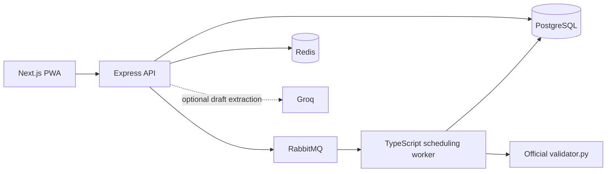

# TechZephyr — CIT Campus Scheduling

TechZephyr is a TypeScript campus-operations platform for generating CIT’s weekly timetable and exams, deciding Spectra venue requests, repairing disruptions with minimal movement, and applying changes through role-based approval. Schedule validity is deterministic and every generated export is checked with the supplied official validator.



Tech stack: Next.js, React, TypeScript, Express, PostgreSQL, RabbitMQ, Redis, Zod and the Python standard-library validator.

## Demo accounts

All accounts use password `TechZephyr!2026`.

| Role | Email |
| --- | --- |
| Admin | `admin@cit.local` |
| Reviewing Admin | `reviewer@cit.local` |
| Department coordinator | `coordinator.cse@cit.local` |
| Faculty | `faculty.cse@cit.local` |
| Club representative | `club@cit.local` |

Two Admin accounts are provided because nobody may approve their own proposal. The Data manager screen includes the required demo-reset action.

## Crunch Week starter pack

Everything you need to build against the Chilika Institute of Technology (CIT) dataset. Read the problem statement first; this file explains the data and the export format.

```
data/cit_public.json          the full dataset (one file, everything in it)
data/csv/*.csv                the same data as spreadsheets, for a quick look
validator.py                  the official validator (Python 3.8+, no installs)
examples/schedule.example.json   shape of the file you export (not a real solution)
examples/sample_disruption.json  practice disruption, same format as the live one
examples/sample_requests.md      plain-language requests to test your AI layer
```

Your app should read this file and change files in the format below, not hard-code anything from them. Judges will reset your app, generate the timetable themselves and apply change files of their own.

## Quick facts about the dataset

| Thing | Count |
| --- | --- |
| Rooms | 27 (classrooms, lecture halls, auditorium, seminar halls, open-air theatre, 7 labs) |
| Faculty | 40 |
| Student groups | 14 (Year 1 sections A to D, Year 2 and Year 3 for 5 branches) |
| Courses | 62 |
| Sessions to schedule | 189 (243 teaching hours a week) |
| Spectra week booking requests | 25 (one of them is cancelled) |
| Midsem exams | 41 |

A timetable with zero hard violations exists for this dataset. We checked.

## Time model

- Days: `MON` to `FRI`.
- Periods `1` to `9` are teaching periods, one hour each: P1 08:00, P2 09:00 ... P5 12:00, lunch 13:00 to 14:00, P6 14:00 ... P9 17:00.
- Periods `10` to `13` (18:00 to 22:00) are for events only.
- A session with `duration` d placed at `start_period` p occupies p, p+1, ... p+d-1. It may not span P5 and P6 (lunch).
- Labs (`kind: "lab"`, 3 hours) start only at P2 or P6.

## The dataset, field by field

### rooms
`id`, `name`, `building`, `type`, `capacity`, `features`, `accessible`, `allowed_uses`.

Room `type` is one of `classroom`, `lecture_hall`, `auditorium`, `seminar_hall`, `outdoor`, `lab_cs`, `lab_elec`, `lab_phy`, `workshop`, `lab_civil`. `allowed_uses` says whether a room can take lectures, tutorials, labs, exams or events. Seminar halls and the open-air theatre never take regular classes.

### room_unavailability
`room_id`, `day`, `periods`, `reason`. The room can't be used at those times.

### faculty
`id`, `name`, `department`, `max_hours_per_day` (hard limit), `needs_accessible`, `unavailable` (list of `day` + `periods`, hard), `preferences` (soft).

A preference looks like `{"type": "avoid", "days": [...], "periods": [...], "note": "..."}`. Each hour a faculty member teaches inside an avoided day and period costs 2 points (S1).

### student_groups
`id`, `name`, `year`, `department`, `size`, `needs_accessible`.

### courses
Reference information: `lecture_hours`, `tutorial_hours`, `lab_blocks` per week. You don't schedule courses; you schedule sessions.

### sessions — the thing you schedule
```json
{
  "id": "MA101-AB-L1",
  "course_id": "MA101",
  "kind": "lecture",               // lecture | tutorial | lab
  "groups": ["Y1-A", "Y1-B"],      // every group that must attend
  "faculty_id": "F19",
  "size": 180,                     // students attending
  "duration": 1,                   // periods
  "room_types": ["classroom", "lecture_hall", "auditorium"],
  "needs_accessible": false,
  "basket_slot": null,             // e.g. "OEB-1" for open electives
  "fixed_slot": null               // e.g. {"day": "THU", "start_period": 6} = must go exactly there
}
```
Each session needs exactly one `day`, `start_period` and `room_id`. Faculty are already assigned.

**Elective baskets.** Year 3 students each take one of three open electives (OE301, OE302, OE303). The three courses run in parallel: every session with the same `basket_slot` must be at the same day and period, in different rooms. Their `groups` lists all Year 3 groups because each group has students in all three. Sessions in the same basket slot don't clash with each other for groups; they do clash with everything else those groups have.

### booking_requests — Spectra week (Week 7)
```json
{
  "id": "BR-07",
  "submitted_at": "2027-01-26T09:45:00+05:30",
  "requester": "Dramatics Society",
  "role": "club",                         // admin | department_coordinator | faculty | club
  "requested_category": "club_event",
  "title": "Stage play: Andha Yug",
  "attendance": 130,
  "duration_periods": 3,
  "windows": [{"day": "THU", "from_period": 10, "to_period": 12}],
  "room_types": ["seminar_hall", "auditorium"],
  "needs": ["stage", "pa_system"],        // "accessible" means the room must be accessible
  "requested_room": "SH-1",               // a wish, may be null, may not even exist
  "mandatory_for_groups": [],             // these groups must be free
  "series_id": null,
  "raw_text": "Dramatics needs SH-1 Thursday 6 to 9 pm ..."
}
```
A booking must fit fully inside one window to be approved. `raw_text` is the original message, so it doubles as test input for your plain-language parser.

**Category is capped by role.** `role_category_cap` in the dataset says the highest category each role may claim. A club asking for `institute_event` is still a `club_event`. Priority order is in `priority_order`; ties go to the earlier `submitted_at`.

**cancellations** lists requests withdrawn after submission. Never approve those.

### exams
`id`, `course_ids`, `groups`, `size`, `duration_hours`. Exam week is `MON` to `SAT` with sessions `AM` (09:30 to 11:30) and `PM` (14:00 to 16:00), in `calendar.exam_week`. Rooms seat half their capacity during exams; an exam may use several rooms.

## What you export: schedule.json

```json
{
  "team": "Your team name",
  "dataset_id": "cit-public-v1",
  "sessions": [
    {"session_id": "MA101-AB-L1", "day": "MON", "start_period": 2, "room_id": "LH-1"}
  ],
  "fest_week": {
    "bookings": [
      {"request_id": "BR-01", "status": "approved", "day": "MON",
       "start_period": 4, "end_period": 5, "room_id": "AUD", "reason": "Institute event"},
      {"request_id": "BR-09", "status": "rejected", "reason": "No venue seats 1,200"},
      {"request_id": "BR-07", "status": "alternative_offered", "day": "THU",
       "start_period": 10, "end_period": 12, "room_id": "AUD", "reason": "SH-1 taken by an earlier request"}
    ],
    "session_overrides": [
      {"session_id": "ID101-ALL-L1", "day": "WED", "start_period": 4, "room_id": "AUD", "displaced_by": "BR-01"}
    ]
  },
  "exams": [
    {"exam_id": "EX-MA101", "day": "MON", "session": "AM", "rooms": ["AUD", "LH-1", "LH-2"]}
  ]
}
```

- `end_period` is inclusive.
- `status` is `approved`, `rejected` or `alternative_offered`. Rejections and alternatives need a `reason`. An alternative may sit outside the requested window; it is half-scored.
- `session_overrides` move a session for Week 7 only. Only an approved institute event may displace a regular session, and the session must be moved, not dropped.
- `exams` is required in `schedule.json`. A missing exam schedule counts every exam as unscheduled. In `schedule_after.json` (after a disruption) it's optional.

## Running the validator

```
python validator.py --data data/cit_public.json --schedule schedule.json
python validator.py --data data/cit_public.json --schedule schedule.json --json report.json
```

Checking a change: apply `examples/sample_disruption.json` in your app, export the repaired timetable, then

```
python validator.py --data data/cit_public.json --schedule schedule_after.json \
                    --disruption examples/sample_disruption.json --baseline schedule.json
```

It prints hard violations by rule, the soft penalty (S1 to S6), the booking score, priority inversions (you rejected someone who should have won a room), and how many sessions moved.

### Disruption file format
```json
{"changes": [
  {"type": "faculty_unavailable", "faculty_id": "F07", "days": ["MON"], "periods": [1,2,3,4,5,6,7,8,9], "reason": "..."},
  {"type": "room_unavailable", "room_id": "CR-102", "days": ["MON","TUE"], "periods": [1,2,3], "reason": "..."},
  {"type": "add_faculty", "faculty": { ...same shape as a faculty entry... }},
  {"type": "add_session", "session": { ...same shape as a session, may have fixed_slot... }},
  {"type": "remove_session", "session_id": "HS201-H2-L2"}
]}
```
Changes are permanent: they hold for every week after they're applied.

If you think the validator is wrong, tell the organisers during the hackathon.

## Backend service

The TypeScript backend is in `src/`. It exposes an Express API, persists immutable dataset and schedule versions in PostgreSQL, dispatches long-running work through RabbitMQ, and uses UUIDv7 for all application, job, request, and idempotency identifiers.

The API contract is available at [docs/openapi.yaml](docs/openapi.yaml) and while running at `GET /openapi.yaml`.

### Run locally

Copy `.env.example` to `.env` before starting. Every variable is listed there. Leave `GROQ_API_KEY` empty unless you want natural-language parsing; scheduling, manual booking, approvals and exports work without it. The values in `.env.example` are local-development placeholders, not production secrets.

| Variable | Purpose |
| --- | --- |
| `DATABASE_URL` | PostgreSQL connection string |
| `RABBITMQ_URL` | RabbitMQ connection string |
| `REDIS_URL` | Redis connection string |
| `ALLOWED_ORIGIN` | Browser origins allowed to call the API |
| `DATA_ROOT` | Dataset directory (`./data`) |
| `VALIDATOR_PATH` | Official `validator.py` |
| `PYTHON_BIN` | Python used to run the validator |
| `GROQ_API_KEY` | Optional Groq key for draft extraction only |
| `GROQ_MODEL` | Groq model name |
| `JWT_SECRET` | Development signing secret; replace before any shared deployment |
| `PORT` | API port, default `3000` |
| `DB_POOL_MAX` | PostgreSQL pool size |

**Docker Compose (full stack)**

1. `cp .env.example .env` and, only if you want AI drafts, set `GROQ_API_KEY` in that file.
2. `docker compose up -d --build`
3. `docker compose ps`, then `curl http://localhost:3000/health`
4. Open the app at `http://localhost:3001` and sign in with a demo account. The API is on port `3000`. Swagger UI is at `http://localhost:8080`.

Compose starts PostgreSQL, RabbitMQ, Redis, the API (including migrations), the worker and the PWA. No host `DATABASE_URL` is required for that path; Compose injects its own local credentials.

**Host processes (without Compose)**

Use this when Docker is not available. PostgreSQL, Redis and RabbitMQ must already be listening on the hosts in `.env.example`.

1. `cp .env.example .env`
2. `npm ci && npm run db:migrate`
3. `npm run dev` for the API and, in a second terminal, `npm run worker`
4. `cd frontend && npm ci && npm run dev`
5. Open `http://localhost:3001`. The frontend proxies `/backend` to `http://localhost:3000`.

End users never type a schedule, dataset, job, room or group identifier. Each screen loads the available records and shows them as cards; the selected identifier is sent by the app.

Use `npm run check` in the repository root, and `npm run check` inside `frontend/`, for TypeScript validation when developing locally.

Only the API is exposed on port `3000`; PostgreSQL, RabbitMQ, and Redis are private to the Compose network. The Compose credentials are for local development only and must be replaced for deployment. `docker compose down` stops services while preserving data; add `-v` only when a full local reset is intended.

### Pooling and cache policy

The PostgreSQL client uses a bounded pool (`DB_POOL_MAX`, default 20), 30-second idle eviction, a 5-second connection timeout, and 30-minute maximum connection lifetime. Transactions obtain and release a single client, while ordinary queries use the shared pool.

Redis uses cache-aside reads. Job-status responses are cached for 10 seconds because worker progress changes frequently; each worker success or failure invalidates that job’s key immediately. Schedule/version cache keys are also invalidated on worker completion. Database state remains authoritative: Redis errors bypass cache reads and writes, never fail an API command, and TTLs limit stale data if an invalidation event is lost.

### Rate limiting

All `/api` routes use a Redis token-bucket limiter keyed by authenticated user ID (or source IP before authentication): 120 requests with a sustained refill of 2 requests/second. AI parsing has an additional 10 requests/minute bucket. Exhausted buckets return `429` with `RateLimit-Limit`, `RateLimit-Remaining`, and `Retry-After` headers. Redis unavailability is logged and fails open so that a cache outage does not make the scheduling system unavailable.

### API documentation and Postman

Import [postman/TechZephyr4.postman_collection.json](postman/TechZephyr4.postman_collection.json) and [postman/TechZephyr4.local.postman_environment.json](postman/TechZephyr4.local.postman_environment.json) into Postman. Before importing data, paste the contents of `data/cit_public.json` into the `citDataset` environment variable as valid JSON. The collection creates a fresh UUIDv7 idempotency key for every write. To verify replay behavior, send the same request again with the same `Idempotency-Key` manually.

The OpenAPI source at [docs/openapi.yaml](docs/openapi.yaml) is the API contract. `docker compose up -d --build` also starts Swagger UI at `http://localhost:8080`, where you can use **Authorize** to set the local demo Admin ID `018f9f69-f6f2-7b01-8a2b-531e5d44e018` and role `admin`, then run requests with **Try it out**. The raw document remains at `http://localhost:3000/openapi.yaml`.

### API behavior

- Write endpoints require `Idempotency-Key` as a UUIDv7. Retrying the same request replays its original response; reusing a key with a different payload returns `409`.
- Development authentication uses `x-user-id` and `x-user-role` headers, which must match a record in `app_user`. Replace this adapter with the deployed identity provider before production.
- Work is written transactionally to the database outbox, then published to the durable RabbitMQ queue. Worker delivery is at least once, so database operations are idempotent.
- The worker runs the deterministic timetable, exam, repair and priority-aware booking engine in `src/application/scheduling/solver.ts`, persists the complete candidate, then runs the supplied `validator.py`. A zero-violation result becomes a pending Admin approval proposal; failures never publish.

### Backend structure

```
src/
  domain/           Pure CIT concepts and request schemas
  application/      Use cases: idempotency, jobs, AI orchestration
  infrastructure/   PostgreSQL, RabbitMQ, configuration, migrations
  interfaces/       Express HTTP API and RabbitMQ worker entry points
```

The dependency direction is inward: HTTP and worker interfaces call application services; application services depend on domain rules and infrastructure interfaces; domain code has no HTTP, database, queue, or AI-provider dependency. This keeps the official validator and future solver adapters replaceable and testable.

### AI setup

Set `GROQ_API_KEY` in your local `.env`; never put it in `README.md`, a Postman environment, or source control. The `/api/v1/ai/booking-drafts` endpoint parses English/Hinglish requests into a schema-validated draft. The draft is always editable and cannot approve, schedule, or override a booking. See [AI_USAGE.md](AI_USAGE.md) for the required hackathon declaration.

## What goes in your exports/ folder

Commit both of these to your repo before the deadline:

- `exports/schedule.json`: your app's output for `cit_public.json` (timetable, exams and Spectra week bookings).
- `exports/schedule_after.json`: the timetable after applying `examples/sample_disruption.json` in your app, starting from that `schedule.json`.

Both must be produced by the app. Files made or edited by hand lead to disqualification.

Regenerate them with `npm run exports:generate`; both commands are also checked by the official validator during release verification.

## Production notes

- Set a unique `JWT_SECRET` of at least 32 characters. The API refuses to boot in production if the development placeholder is still set.
- Header auth (`x-user-id`) is off when `NODE_ENV=production`. Sign in with email and password. Access tokens refresh through `/api/v1/auth/refresh` and logout revokes the refresh token.
- Logs are JSON via Winston in production (`LOG_LEVEL`). They include request id, status, and duration, and they do not include passwords or tokens.
- The workspace has a bottom-right voice button. It drafts a booking or a schedule change and speaks the result. `llm-guardrails` blocks injection, secrets, and any request to approve or skip the validator.
- GitHub Actions (`.github/workflows/ci.yml`) typechecks the API and the web app, then builds the API image.

## Known limitations

- Natural-language draft extraction requires a configured Groq key; all deterministic scheduling, manual event entry and dataset workflows continue without it.
- The included optimiser prioritises a fast zero-hard-violation solution and baseline stability. Its soft score is deterministic but is not guaranteed to be the global optimum.
- Deployment-specific identity, TLS and secret management must replace the local demo credentials before production use.
